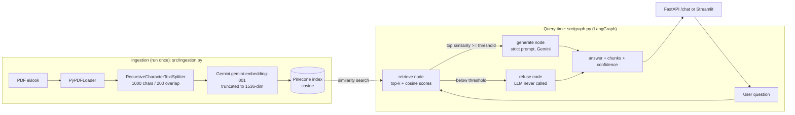

# RAG-based Agentic AI Chatbot

A Retrieval-Augmented Generation chatbot that answers questions **strictly** from the *Agentic AI* eBook.
Built with **Python, LangGraph, Pinecone, Google Gemini, FastAPI** (plus an optional **Streamlit** UI).

Every response returns:

1. the generated **answer**
2. the **retrieved context chunks** (with page number and cosine similarity)
3. a **confidence score** computed from real similarity scores (not hard-coded)

Questions the document cannot answer (e.g. *"Who won the 2022 FIFA World Cup?"*) are **refused**.

---

## Architecture



```
question ──► retrieve ──┬─ sim ≥ MIN_RELEVANCE_SCORE ─► generate ──► END
                        └─ sim <  MIN_RELEVANCE_SCORE ─► refuse   ──► END
```

### Design decisions

| Concern | Decision | Why |
|---|---|---|
| Grounding | 3 layers: refusal gate, strict system prompt, score reset if the LLM refuses | Prompt-only grounding is not reliable; the gate guarantees off-topic questions never reach the LLM |
| Confidence score | `0.7 × norm(best cosine) + 0.3 × norm(mean cosine)`, where norm maps `[SCORE_FLOOR, SCORE_CEILING] → [0, 1]` | Based on actual retrieval quality; the mean penalises a single lucky chunk. Refusals score 0 |
| Refusal threshold | `MIN_RELEVANCE_SCORE` (starting value 0.50), calibrated from data with `scripts/calibrate_threshold.py` | Cosine scales differ between embedding models, so the threshold is measured, not guessed |
| Idempotent ingestion | Deterministic chunk ids (SHA-1 of page + position + text) | Re-running upserts instead of duplicating vectors |
| Gemini embeddings | `gemini-embedding-001` truncated to 1536 dims (Matryoshka); the wrapper uses `RETRIEVAL_DOCUMENT` for ingestion and `RETRIEVAL_QUERY` for search | Keeps the assignment's 1536-dim index while using retrieval-tuned embeddings |
| Rate limits | Ingestion embeds in small batches with backoff on HTTP 429 | Works on Gemini free-tier quotas; safe to retry because ids are deterministic |
| Index safety | Creates index if missing; errors if an existing index has the wrong dimension/metric | Prevents silent embedding-dimension mismatches |
| Testability | `build_rag_graph()` accepts an injected vector store and LLM | 22 offline tests run with no API keys |
| API concurrency | `/chat` is a sync `def` so blocking network calls run in FastAPI's thread pool | Doesn't block the event loop |
| Transparency | Refused answers still return the retrieved chunks and similarity | Lets a reviewer see *why* it refused |

### Project structure

```
rag-agentic-ai/
├── data/                         # downloaded PDF goes here (git-ignored)
├── src/
│   ├── config.py                 # env + constants + tunable settings
│   ├── ingestion.py              # download, load, split, Pinecone index setup, upsert
│   └── graph.py                  # LangGraph state, nodes, routing, scoring
├── scripts/calibrate_threshold.py # derives refusal threshold + score range from your data
├── tests/test_offline.py         # 22 offline unit/API tests (mocked Gemini/Pinecone)
├── app.py                        # FastAPI application
├── streamlit_app.py              # optional Streamlit UI
├── tests_sample_queries.py       # 6 benchmark queries against the API / graph
├── docs/DESIGN_WALKTHROUGH.md    # line-by-line explanation and Q&A
├── requirements.txt / requirements-dev.txt
├── .env.example
└── README.md
```

---

## Setup

**Prerequisites:** Python 3.10+, a Gemini API key (free at <https://aistudio.google.com/apikey>), a Pinecone API key (free tier is enough).

```bash
git clone <your-repo-url> rag-agentic-ai && cd rag-agentic-ai

python -m venv venv
source venv/bin/activate            # Windows: venv\Scripts\activate

pip install -r requirements.txt

cp .env.example .env                # Windows: copy .env.example .env
# edit .env and set GOOGLE_API_KEY and PINECONE_API_KEY
```

## Ingestion (run once)

Downloads the eBook from Google Drive to `data/Ebook-Agentic-AI.pdf`, splits it, embeds it and upserts to Pinecone
(the index is created automatically: 1536 dimensions, cosine).

```bash
python -m src.ingestion --download
```

Other options:

```bash
python -m src.ingestion              # re-ingest an already downloaded PDF (safe to repeat)
python -m src.ingestion --reset      # clear the namespace first, then ingest
```

> If the automatic download is blocked by Google Drive, open the
> [eBook link](https://drive.google.com/file/d/15VLphKcY23_fpYxN62UEQRri_psRVfP9/view),
> save it as `data/Ebook-Agentic-AI.pdf`, and run `python -m src.ingestion`.

## Calibrate the refusal threshold (once, after ingestion)

Embedding models produce different similarity ranges, so measure instead of guessing. This runs in-scope and
out-of-scope questions through the retriever (no LLM calls) and prints values to paste into `.env`:

```bash
python -m scripts.calibrate_threshold
```

## Run the API

```bash
uvicorn app:app --reload
```

Interactive docs: <http://127.0.0.1:8000/docs>

```bash
curl -X POST http://127.0.0.1:8000/chat \
  -H "Content-Type: application/json" \
  -d '{"query": "What is Agentic AI according to the eBook?"}'
```

Response shape:

```json
{
  "answer": "...",
  "retrieved_chunks": [
    {"rank": 1, "page": 4, "similarity": 0.61, "text": "..."}
  ],
  "confidence_score": 0.83,
  "grounded": true,
  "top_similarity": 0.61
}
```

## Run the Streamlit UI (optional)

```bash
streamlit run streamlit_app.py
```

Chat on the left; retrieved chunks and confidence score in the sidebar.

## Tests

**Offline tests** (no API keys needed):

```bash
pip install -r requirements-dev.txt
pytest -q
```

**Sample benchmark queries** (needs ingestion done and the API running in another terminal):

```bash
python tests_sample_queries.py            # via the API
python tests_sample_queries.py --direct   # or straight through the graph
```

This runs 6 queries (5 in-scope, plus the FIFA question as the out-of-scope validation test) and writes
`sample_outputs.md` / `sample_outputs.json`.

### Tuning the refusal threshold

Use `python -m scripts.calibrate_threshold` (see above). You can also read `top_similarity` in the sample-query
output: set `MIN_RELEVANCE_SCORE` between the highest out-of-scope value and the lowest in-scope value.

---

## Sample query results

<!-- Run `python tests_sample_queries.py`, then paste the contents of sample_outputs.md below. -->

_Paste the output of your own run here._

---

## Tech stack

Python 3.10+ · LangChain / LangGraph · Google Gemini (`gemini-embedding-001`, `gemini-3.1-flash-lite`) · Pinecone serverless ·
FastAPI + Uvicorn · Streamlit · pypdf · pytest
